# FHIR Verity

Fhir Verity ist eine Server-weite Datenqualitäts-Validierung und Bereinigung für FHIR-Server.

FHIR Verity liest den vollständigen Ressourcen-Bestand eines FHIR-Servers, prüft ihn gegen **konfigurierbare Qualitätsregeln** in vier Dimensionen (**Pseudonymisierung/Datenschutz, Vollständigkeit, Plausibilität, referentielle Integrität**), speichert die invaliden Ressourcen samt Befund und stellt einen Bereinigungs-Workflow bereit. Die Ergebnisse werden zusätzlich als FHIR-konforme Reports (`VerificationResult`, `TestReport`) auf den geprüften Server zurückgeschrieben.

## Ziel

Bestehende FHIR-Validatoren prüfen einzelne Ressourcen oder Bundles gegen Profile. Was in der Praxis fehlt, ist zweierlei: die Prüfung eines **kompletten Server-Bestands** in einem Durchlauf, und Qualitätskriterien, die über reine Profilkonformität hinausgehen — etwa ob Pseudonymisierung tatsächlich greift, ob Pflichtfelder gefüllt sind, ob Werte plausibel sind und ob Referenzen ins Leere zeigen oder unplausibel sind. Genau diese Lücke schließt Verity.

## Architektur in einem Satz

Vier Container hinter einem Reverse Proxy: ein FastAPI-Backend, ein [https://tanstack.com/start/latest/docs/framework/react/overview](TanStack-Start-Frontend) , eine PostgreSQL-Datenbank und [https://caddyserver.com/docs/getting-started](Caddy) als einziger nach außen offener Dienst. Caddy terminiert TLS und leitet `/api/*` an das Backend wenn gewünscht `/kc` an Keycloack, alles andere an das Frontend — dadurch gibt es nur eine Origin, kein CORS und keine standortspezifisch eingebackene Backend-URL. Details in [documentation/architektur.md](documentation/architektur.md).

## Schnellstart

Es gibt zwei Betriebsarten. Für einen produktiven Standort ist Docker Empfohlen.

### Mit Docker (empfohlen)

Voraussetzung: Docker Engine und das Compose-Plugin. Für die Datenbank gibt es zwei Wege:

- **Eigene externe PostgreSQL (Standard):** Es gibt am Standort bereits eine PostgreSQL. In der `.env` wird nur die `DATABASE_URL` auf diesen Host gesetzt.
- **Mitgelieferte PostgreSQL:** Es gibt keine. Dann in der `docker-compose.yml` die mit "Weg B" markierten Blöcke einkommentieren: Es wird dann einen eigenen Datenbank-Container mit, es muss nichts vorab angelegt werden.

Für die Anmeldung genauso:

- **Eigener Keycloak (Standard):** In der `.env` die `KEYCLOAK_*`-Werte des Standort-Keycloak eintragen.
- **Mitgelieferter Keycloak:** Es gibt keinen. Dann in der `.env` den Block "Weg 2" einkommentieren: Es wird einen fertig eingerichteten Keycloak unter `https://<DOMAIN>/kc` gestartet.

```bash
git clone <repo-url> fhir-verity
cd fhir-verity
cp .env.example .env
# .env mit echten Werten füllen (Domain, Passwörter, Keycloak, SMTP falls vorhanden)
docker compose up -d --build
docker compose logs -f backend

```

Die vollständige Anleitung inklusive Keycloak-Einrichtung, Zertifikaten und beiden Datenbank-Wegen steht in [documentation/deployment.md](documentation/deployment.md).

### Lokal 

Voraussetzung: Python 3.12+, Node 22+, pnpm (oder ein anderer Paketmanager), eine PostgreSQL.

1. Backend:

```bash
cd backend
python -m venv .venv && source .venv/bin/activate   # Windows: .venv\Scripts\activate
pip install -r requirements.txt
cp .env.example .env
# .env auf die lokale Datenbank und deinen Keycloak zeigen lassen,
# oder ohne Keycloak: AUTH_ENABLED=false (nur mit ENVIRONMENT=development)
alembic upgrade head
uvicorn app.main:app --reload
```

2. Frontend:

```bash
cd frontend
pnpm install # npm, bun oder yarn funktionieren ebenso
cp .env.example .env
pnpm dev
```

Das Frontend läuft dann auf `http://localhost:3000`, das Backend auf `http://localhost:8000`.

## Dokumentation

Die ausführliche Dokumentation liegt im Ordner `documentation/`:

- [fhir-verity.md](documentation/fhir-verity.md) — Was das Tool ist, Kontext, Abgrenzung
- [architektur.md](documentation/architektur.md) — Die vier Container, Single-Origin, Datenfluss
- [features.md](documentation/features.md) — Validierungsdimensionen, Crawl, Reports, Bereinigung
- [validierungsregeln.md](documentation/validierungsregeln.md) — Alle Ressourcentypen und Regeln im Detail, neue Regel hinzufügen
- [datenbank.md](documentation/datenbank.md) — Die beiden DB-Wege, Migrationen, PostgreSQL-Rechte
- [schema.md](documentation/schema.md) — Tabellen, Spalten, Beziehungen
- [rollenverwaltung.md](documentation/rollenverwaltung.md) — RBAC, Server-Ownership, Audit
- [deployment.md](documentation/deployment.md) — Vollständige Deployment-Anleitung

## Screenshots

---

### Login and Welcome Page

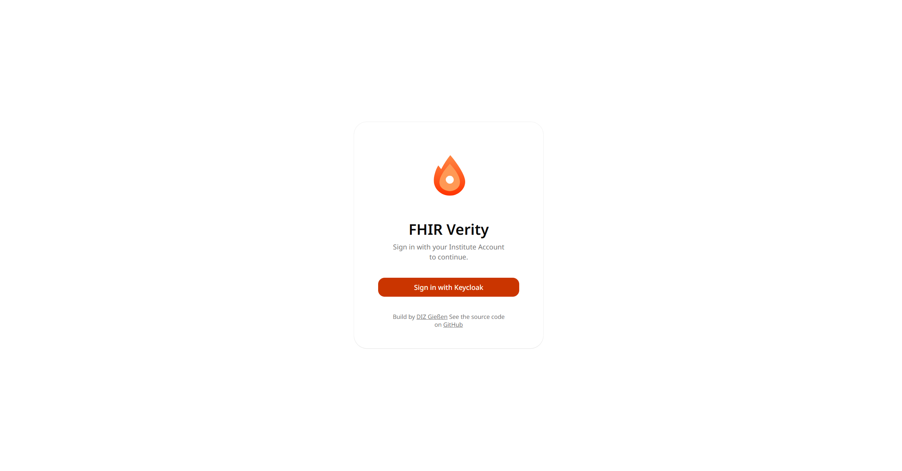

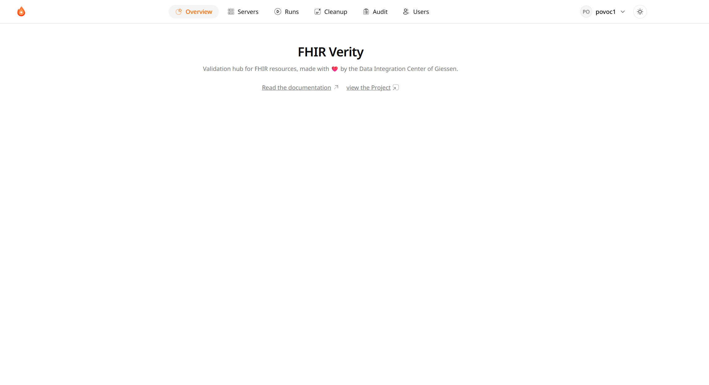

### Server Pages

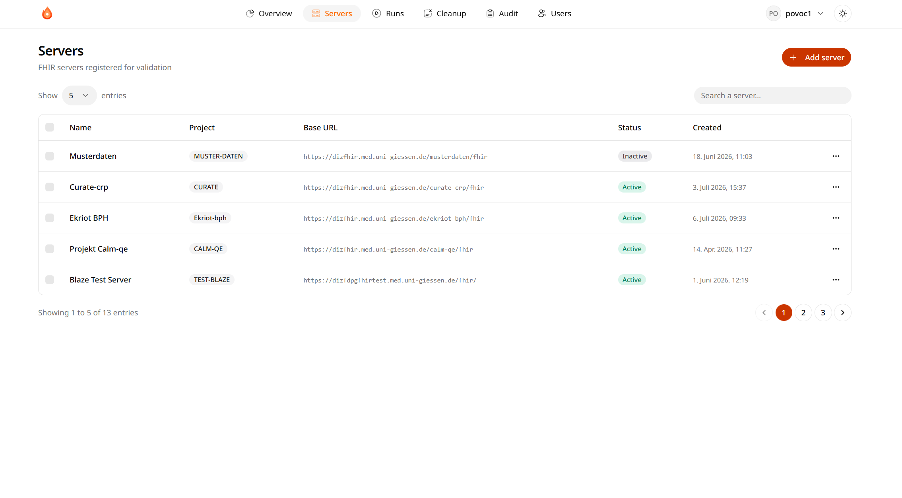
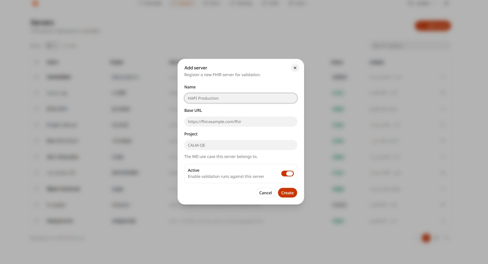
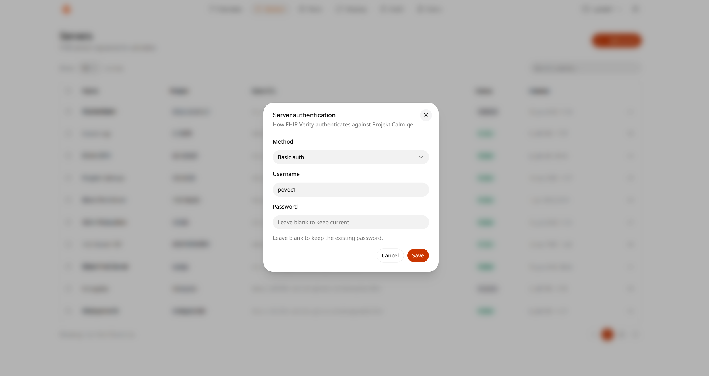
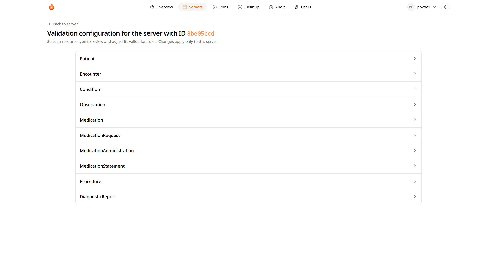
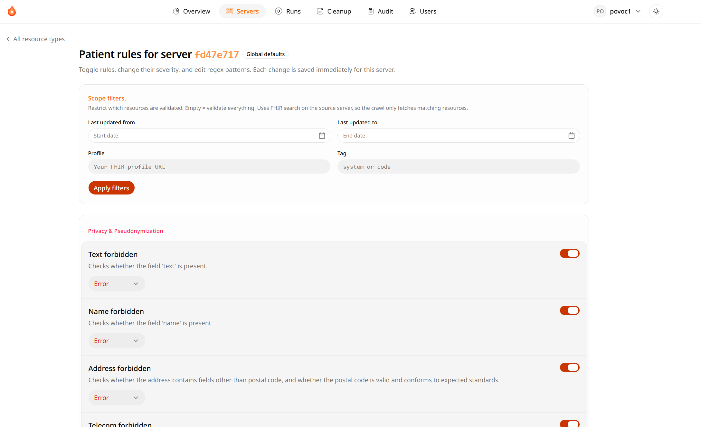

### Runs Page

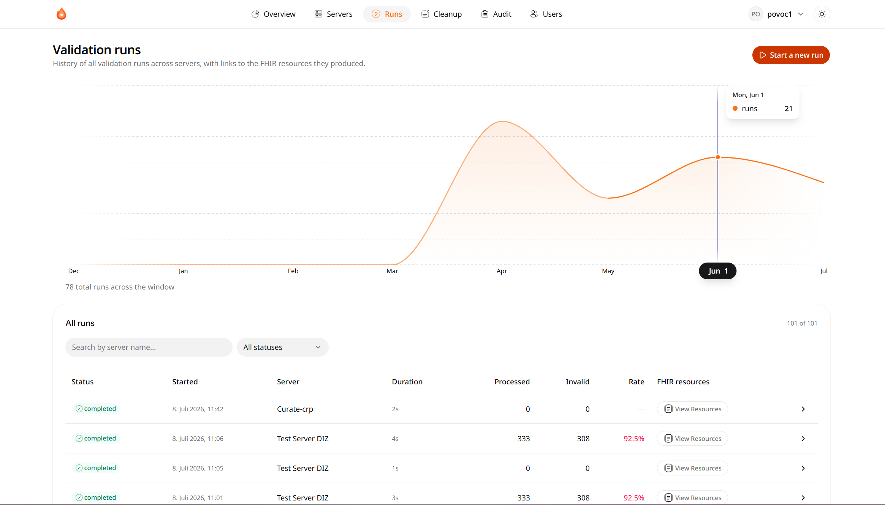
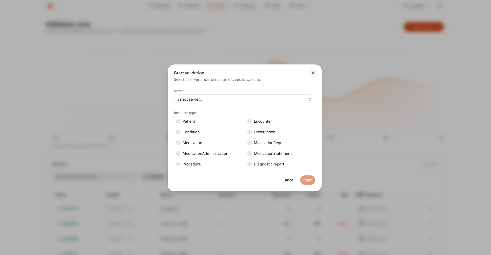

### Detail Run Page

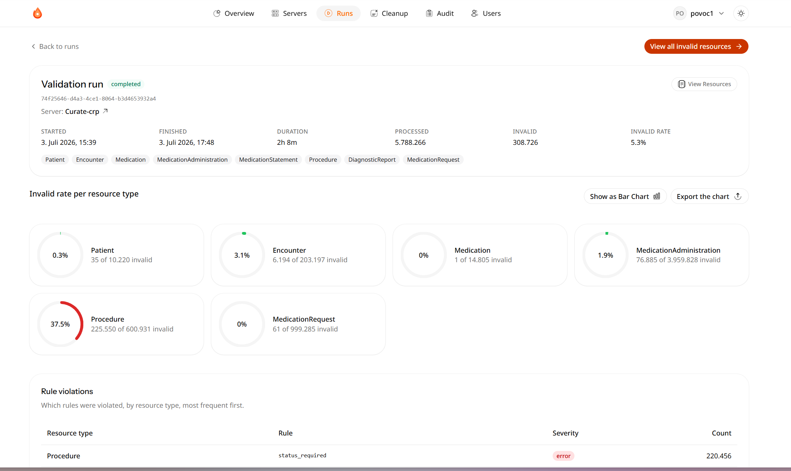
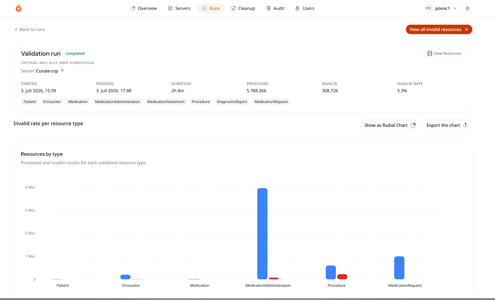
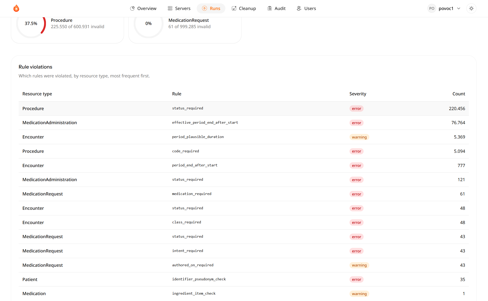

### Invalid Resource Page

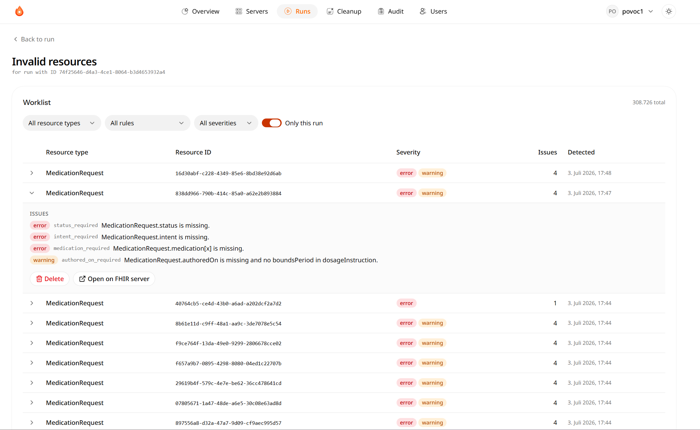
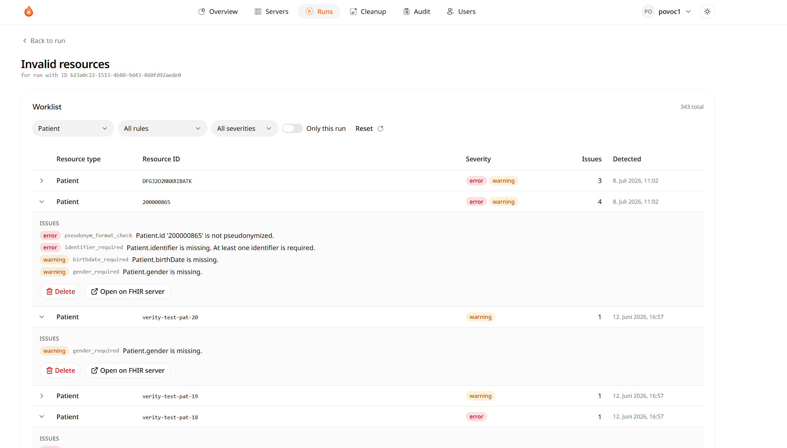

### Cleanup Page

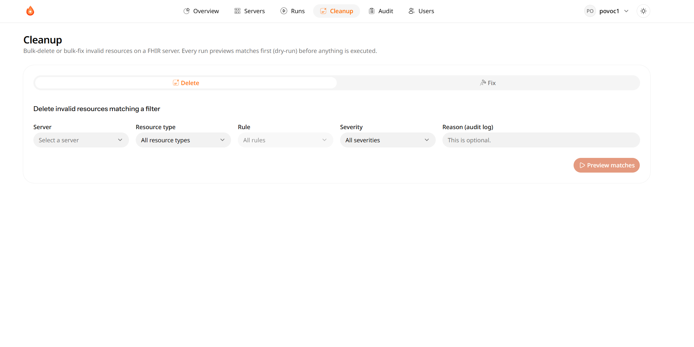

### Audit Page

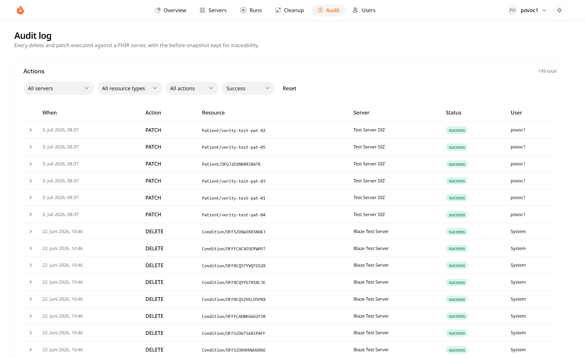

### User Management Page

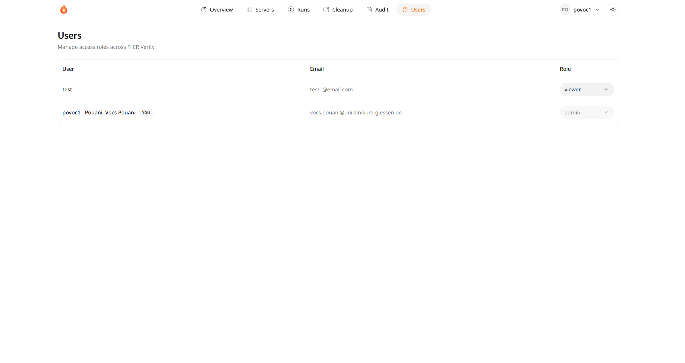
