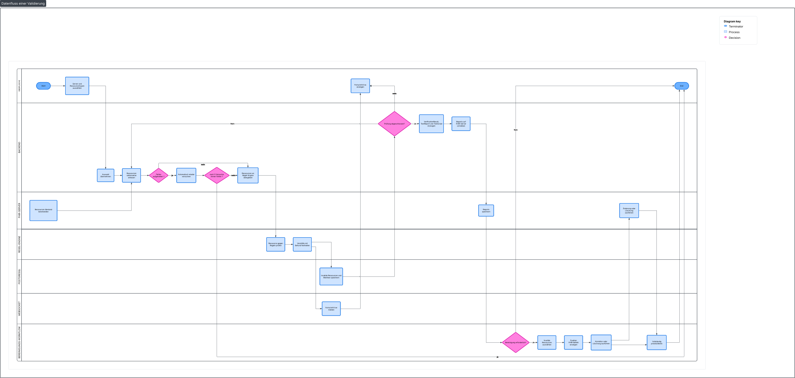

# Architektur

## Überblick

Verity läuft als Verbund von vier Diensten, die im Docker-Betrieb jeweils ein eigener Container sind und über ein internes Netzwerk miteinander sprechen:

- **backend**
  - FastAPI (Python 3.12)
  - die gesamte Logik:
    - FHIR-Client
    - Regel-Engine
    - Persistenz
    - Auth
    - Report-Erzeugung.
- **frontend**
  - TanStack Start (Node 22, Nitro-Server)
  - die Weboberfläche.
- **db**
  - PostgreSQL, die Datenbank für Veritys eigene Daten.
- **caddy**
  - Reverse Proxy
  - TLS-Terminierung, der einzige nach außen sichtbare Dienst.
- **Keycloak** 

Der geprüfte FHIR-Server ist **nicht** Teil dieses Verbunds. Verity spricht ihn über HTTP an wie jeder andere Client; er kann am selben Standort, aber auch anderswo stehen.

## Single-Origin: warum Caddy davor sitzt

Der zentrale Entwurfsgedanke ist, dass von außen nur eine einzige Adresse sichtbar ist. Ohne einen Reverse Proxy hätte man zwei Dienste auf zwei Adressen — Frontend auf Port 3000, Backend auf Port 8000. Das zieht drei Probleme nach sich: Man braucht CORS-Regeln, damit das Frontend das Backend überhaupt aufrufen darf; man muss die Backend-URL zur Build-Zeit ins Frontend einbacken, was das Image standortabhängig macht; und man öffnet zwei Ports nach außen.

Caddy löst das, indem es als einziger Dienst nach außen lauscht und intern nach Pfad verteilt:

```bash
{$DOMAIN} {
    handle /api/* {
        reverse_proxy backend:8000
    }
    #...
    handle {
        reverse_proxy frontend:3000
    }
    tls internal
}
```

Alles kommt über dieselbe Origin herein. Anfragen mit dem Pfadpräfix `/api/` gehen an das Backend, alles andere an das Frontend. Für den Browser sind Frontend und Backend damit dieselbe Herkunft — kein CORS nötig. Das Frontend ruft die API relativ auf (leere Basis-URL), sodass dasselbe Image an jedem Standort funktioniert, egal unter welcher Domain es läuft.

`backend:8000` und `frontend:3000` sind dabei keine öffentlichen Adressen, sondern die **Servicenamen** aus der Compose-Datei. Container erreichen sich im internen Docker-Netzwerk über diese Namen (siehe unten).

Statt Caddy könnte problemlos auch Nginx eingesetzt werden – beide erfüllen in dieser Architektur denselben Zweck als Reverse Proxy und TLS-Terminierer. Die Entscheidung für Caddy fiel aus pragmatischen Gründen: Die Konfiguration ist deutlich einfacher und auch für Anwender:innen ohne tiefgehende Vorkenntnisse schnell verständlich. Der Caddy-Container ist so gestaltet, dass er direkt einsatzbereit ist und keine komplexen Anpassungen erfordert.


## Das interne Netzwerk und die Port-Sichtbarkeit

Docker Compose legt automatisch ein internes Netzwerk an, in dem sich die Container über ihren Servicenamen finden. Deshalb steht in der Datenbank-Verbindung des Backends der Host `db` und nicht `localhost` — `db` ist der Name des PostgreSQL-Service, und im internen Netzwerk löst dieser Name auf den richtigen Container auf.

Entscheidend für die Sicherheit ist die Unterscheidung zwischen `expose` und `ports` in der Compose-Datei:

- `expose` macht einen Port nur **im internen Netzwerk** sichtbar. Backend (8000) und Frontend (3000) sind so gesetzt — Container untereinander erreichen sie, von außen kommt niemand direkt ran.
- `ports` öffnet einen Port **nach außen** auf den Host. Nur Caddy hat das (443). Damit ist Caddy der einzige Eingang, und Backend, Frontend und Datenbank sind von außen nicht direkt erreichbar.

## TLS

Caddy terminiert HTTPS. Ist der Server öffentlich aus dem Internet erreichbar, holt Caddy automatisch ein Let's-Encrypt-Zertifikat. Für einen rein intern erreichbaren Server funktioniert das nicht, weil Let's Encrypt den Server zur Prüfung nicht erreichen kann. Für diesen Fall steht im Caddyfile `tls internal`: Caddy erzeugt eine eigene lokale CA und stellt sich das Zertifikat selbst aus. HTTPS funktioniert damit voll, der Browser zeigt beim ersten Zugriff eine Zertifikatswarnung, die für einen Testserver durchgeklickt wird. Gibt es später ein bereitgestelltes Zertifikat, wird `tls internal` durch `tls /pfad/cert.pem /pfad/key.pem` in `Caddyfile` ersetzt.

HTTPS ist im Produktionsmodus zwingend, weil das Session-Cookie dann mit dem `Secure`-Flag gesetzt wird und über reines HTTP gar nicht übertragen würde.

## Datenfluss einer Validierung

1. Ein Validierungslauf wird über die Oberfläche gestartet und ausgewählt, welcher Server und welche Ressourcentypen geprüft werden.
2. Das Backend liest den Ressourcen-Bestand des FHIR-Servers seitenweise ein. Die Crawl-Architektur ist so ausgelegt, dass sie über sehr große Bestände stabil bleibt, bei Fehlern zurücksetzt und ein unterbrochener Lauf wieder aufgenommen werden kann.
3. Jede Ressource durchläuft die Regel-Engine. Verstöße werden pro Ressource mit dem konkreten Befund festgehalten.
4. Invalide Ressourcen und Metriken werden in PostgreSQL gespeichert. Der Fortschritt wird währenddessen über WebSocket live an die Oberfläche gemeldet.
5. Am Ende erzeugt Verity FHIR-konforme Report-Ressourcen (`VerificationResult`, `TestReport`, `TestScript`) und schreibt sie auf den geprüften Server zurück.
6. Über den Bereinigungs-Workflow können invalide Ressourcen anschließend gezielt von dem jeweiligen Server korrigiert oder gelöscht werden — jede Aktion mit vorheriger Anzeige des exakten FHIR-Befehls und vollständiger Protokollierung.

## Authentifizierung

Die Anmeldung läuft über Keycloak per OpenID Connect im Backend-for-Frontend-Muster (BFF). Das heißt, das Backend führt den
OIDC-Ablauf durch und verwaltet eine serverseitige Session; das Frontend hält kein Token, sondern nur ein Session-Cookie. Der Ablauf: Das Frontend leitet auf `/api/v1/auth/login`, das Backend leitet weiter zu Keycloak, Keycloak leitet
nach erfolgreicher Anmeldung zurück auf `/api/v1/auth/callback`, das Backend legt die Session an und leitet zurück in die Oberfläche. Standorte ohne eigenen Keycloak
können den mitgelieferten zuschalten (`docker-compose.keycloak.yml`). Für lokale Entwicklung lässt sich die Anmeldung mit `AUTH_ENABLED=false` abschalten;
dann arbeitet jede Anfrage als eingebauter Admin `dev`, in Produktion verweigert das Backend diesen Modus. Details in
[rollenverwaltung.md](rollenverwaltung.md) und [deployment.md](deployment.md).

## Migrationen beim Start

Der Backend-Container führt vor dem Start der eigentlichen Anwendung die Datenbank-Migrationen aus. Das erledigt das Startskript `docker-entrypoint.sh`, das zuerst `alembic upgrade head` aufruft und erst danach uvicorn startet. Schlägt die Migration fehl, bricht der Start ab, statt
mit einer halb migrierten Datenbank weiterzulaufen. Warum das so wichtig ist
und wie das Migrationskonzept aufgebaut ist, steht in [datenbank.md](datenbank.md).
